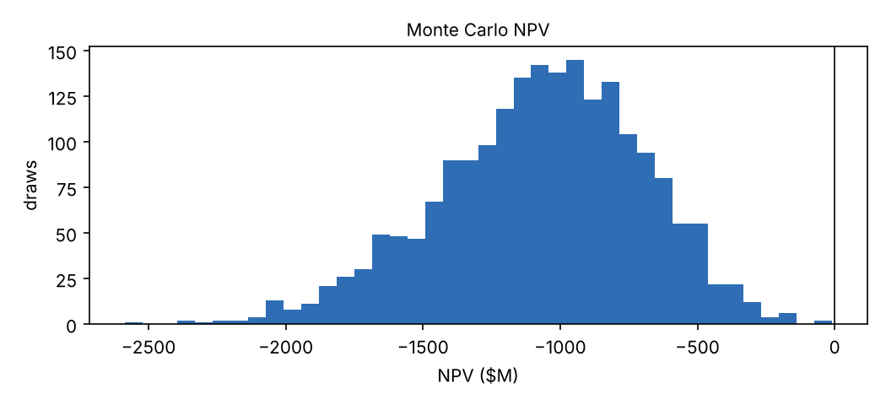

# Sorted wet organics to hydrothermal liquefaction SAF: TEA results

## Conventions

- Real 2026 US dollars (pre-tax). Canadian and euro figures converted at the fx rates below.
- Unit costs are entered at NOAK (Nth of a kind). The cost of getting there is shown separately with Wright's-law learning curves.
- **Boundary:** Wet organic waste at the gate to SAF and co-products at the plant gate. Excludes collection.
- **Functional units:** Levelized SAF supply cost ($/t fuel); cost of CO2e avoided ($/t).
- Company discount rate 10%, customer discount rate 8%, horizon 15 years.

## Headline

| Metric | Value |
|---|---|
| NPV | -$917.0M |
| IRR | -6% |
| Probability NPV > 0 (Monte Carlo) | 0% |
| Peak cash need | $2.22B |
| Cash breakeven year | not within horizon |
| Revenue in final year | $250.2M |
| NOAK reached in year | 12 |
| Extra cost paid while learning (FOAK to NOAK) | $242.6M |
| NPV if costs started at NOAK (no learning period) | -$776.7M |

## Customer cost vs BAU

**SAF supply cost (levelized over plant life)** ($/t fuel)

| Option | Value | vs ours |
|---|---|---|
| Ours at NOAK (MSP) | $3,274 | 1.00x |
| Ours, first plant (FOAK MSP) | $4,346 | 1.33x |
| HEFA SAF market price (incumbent SAF) | $2,214 | 0.68x |
| Projected SAF price in 2035 (this model) | $1,718 | 0.52x |
| Fossil jet | $735 | 0.22x |
| Fossil jet + ReFuelEU penalty | $3,693 | 1.13x |

MSP credits co-products and other revenue. The penalty is at least twice the SAF-jet price gap per tonne missed.

**Cost of CO2e avoided** ($/t CO2e)

| Option | Value | vs ours |
|---|---|---|
| Ours at NOAK | $834 | 1.00x |
| HEFA SAF at market price | $455 | 0.55x |

Price premium over fossil jet divided by life-cycle CO2e avoided per tonne.

**Mass balance per plant (t/yr at 100% availability)**

| Stream | t/yr |
|---|---|
| feed | 300,000 |
| dry | 75,000 |
| biocrude | 30,000 |
| fuel | 24,000 |
| saf range | 12,000 |

## FOAK to NOAK

Cost multiplier vs the incumbent's cost for each component (1.00 = incumbent).

| Component | FOAK | NOAK |
|---|---|---|
| plant capex | 1.47 | 1.00 |

## Cash flow

| Year | Phase | Revenue | Gross profit | Operating cost | EBIT | Capex | Cumulative cash | Cost vs incumbent |
|---|---|---|---|---|---|---|---|---|
| 1 | R&D | $0 | $0 | $20.0M | -$20.0M | $0 | -$20.0M | 1.47 |
| 2 | R&D | $0 | $0 | $20.0M | -$20.0M | $0 | -$40.0M | 1.47 |
| 3 | commercial | $0 | $0 | $10.0M | -$10.0M | $140.9M | -$190.9M | 1.47 |
| 4 | commercial | $0 | $0 | $10.0M | -$10.0M | $140.9M | -$341.7M | 1.47 |
| 5 | commercial | $16.7M | -$815,528 | $10.5M | -$11.3M | $124.0M | -$477.0M | 1.29 |
| 6 | commercial | $32.9M | $9.4M | $11.0M | -$1.6M | $124.0M | -$602.6M | 1.29 |
| 7 | commercial | $48.7M | $7.7M | $11.5M | -$3.8M | $115.0M | -$721.4M | 1.20 |
| 8 | commercial | $64.1M | $17.1M | $11.9M | $5.1M | $224.1M | -$940.4M | 1.14 |
| 9 | commercial | $79.0M | $14.5M | $12.4M | $2.1M | $213.8M | -$1.15B | 1.09 |
| 10 | commercial | $109.3M | $21.2M | $13.3M | $7.9M | $205.9M | -$1.35B | 1.05 |
| 11 | commercial | $138.7M | $27.2M | $14.2M | $13.0M | $199.6M | -$1.54B | 1.02 |
| 12 | commercial | $167.5M | $32.5M | $15.0M | $17.5M | $194.4M | -$1.71B | 1.00 |
| 13 | commercial | $195.7M | $37.1M | $15.9M | $21.3M | $192.0M | -$1.88B | 1.00 |
| 14 | commercial | $223.2M | $41.2M | $16.7M | $24.5M | $192.0M | -$2.05B | 1.00 |
| 15 | commercial | $250.2M | $44.7M | $17.5M | $27.2M | $192.0M | -$2.22B | 1.00 |

Revenue in the final year by stream:

- saf: $130.4M (52%)
- coproducts: $76.5M (31%)
- gate_fees: $43.4M (17%)

## Break-evens

| Question | Answer | Base input |
|---|---|---|
| Annual decline in SAF premium for NPV = 0 | -0.0407 | 0.04 |
| Long-run SAF premium floor ($/t) for NPV = 0 | no crossing in range | 700 |
| Biocrude yield for NPV = 0 | no crossing in range | 0.4 |
| NOAK capex per t/yr wet feed for NPV = 0 | 223 | 640 |
| Gate fee for NPV = 0 | 122 | 20 |

## Scenarios

| Scenario | NPV | Final-year revenue | Peak cash need |
|---|---|---|---|
| Source-separated food waste (no sorting cost) | -$778.5M | $250.2M | $2.05B |
| Higher jet cut (65%) | -$849.0M | $266.4M | $2.12B |
| Food waste gate fee $60/t (composting-level) | -$558.6M | $336.9M | $1.79B |
| SAF premium holds at today's level | -$666.9M | $311.7M | $1.96B |
| SAF premium falls 8%/yr | -$943.9M | $244.2M | $2.29B |

## Sensitivity (one input at a time)

| Input | Low | NPV at low | High | NPV at high |
|---|---|---|---|---|
| `htl.capex_per_wet_t` | 400 | -$389.8M | 1,125 | -$1.86B |
| `waste.gate_fee` | 0 | -$1.06B | 70 | -$469.0M |
| `finance.company_discount_rate` | 0.08 | -$1.03B | 0.15 | -$682.4M |
| `htl.biocrude_yield` | 0.25 | -$1.08B | 0.5 | -$776.2M |
| `sort.cost` | 0 | -$778.5M | 40 | -$1.08B |
| `market.premium_decline` | 0.0 | -$666.9M | 0.1 | -$945.4M |
| `market.jet_price` | 600 | -$1.02B | 950 | -$747.5M |
| `htl.var_opex` | 250 | -$806.2M | 650 | -$1.06B |
| `htl.moisture` | 0.7 | -$804.3M | 0.82 | -$1.06B |
| `learning.rate_capex` | 0.05 | -$828.4M | 0.2 | -$1.05B |
| `learning.noak_experience` | 4 | -$837.5M | 15 | -$1.03B |
| `company.rd_years` | 1 | -$1.00B | 3 | -$821.6M |
| `htl.availability` | 0.65 | -$1.05B | 0.92 | -$867.3M |
| `htl.jet_share` | 0.3 | -$1.01B | 0.65 | -$849.0M |
| `market.premium_floor` | 300 | -$944.1M | 1,100 | -$802.1M |

## Monte Carlo

2,000 draws, triangular distribution on every input with a range.

| P10 | P50 | P90 | P(NPV > 0) |
|---|---|---|---|
| -$1.58B | -$1.04B | -$611.9M | 0% |

## Kill metrics

| Metric | Value | Threshold | Passes |
|---|---|---|---|
| NOAK MSP vs HEFA SAF price | 1.48 x (<=1 to win) | 1.00 | no |
| NOAK MSP vs projected 2035 SAF price | 1.91 x (<=1 to win) | 1.00 | no |
| Cost of CO2e avoided at NOAK | 833.88 $/t (<=300) | 300.00 | no |
| Biocrude yield on dry food waste | 0.40 t/t dry (>=0.40) | 0.40 | yes |
| Revenue at full scale vs big-enough line | 0.25 x | 1.00 | no |
| Probability NPV > 0 | 0% | 50% | no |

## Scorecard

Economics is scored from P(NPV > 0); the rest are judgment scores set in the inputs file.

| Category | Weight | Score |
|---|---|---|
| impact | 20% | 3 |
| breakthrough | 20% | 3 |
| feasibility | 15% | 3 |
| economics | 15% | 1 |
| scalability | 10% | 3 |
| demand | 10% | 5 |
| white space | 5% | 3 |
| validation | 5% | 3 |
| **Weighted total** | | **2.90** |

## Notes

- All carbon is biogenic, so all SAF-range fuel counts toward ReFuelEU.
- Market check: 11 plants at maturity make 112 kt/yr of SAF-range fuel, 1.2% of the ~9.2 Mt/yr the EU mandate requires in 2035.
- One mature plant: 10.2 kt/yr SAF-range fuel (0% from fossil carbon), 10.2 kt/yr co-products.
- SAF price path: premium over jet $1,362/t in model year 1 (2027), $983/t in 2035, $769/t in year 15.
- NPV and IRR include the remaining-life operating cash of plants built within the 15-yr horizon (no new builds after it) while it stays positive; 24 tail years counted. NPV over the horizon alone: $-990M.
- Pre-tax, real 2026 USD; operating profit is before depreciation.

