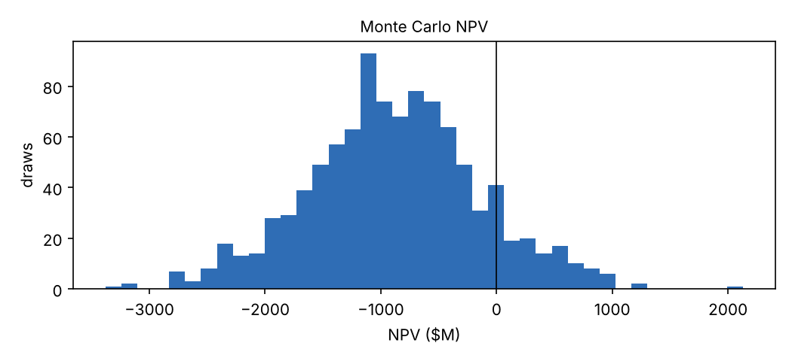

# Trash refinery: sorted MSW to gasification + Fischer-Tropsch SAF: TEA results

## Conventions

- Real 2026 US dollars (pre-tax). Canadian and euro figures converted at the fx rates below.
- Unit costs are entered at NOAK (Nth of a kind). The cost of getting there is shown separately with Wright's-law learning curves.
- **Boundary:** Residual MSW at the gate to SAF, co-products and recyclables at the plant gate. Excludes collection.
- **Functional units:** Levelized SAF supply cost ($/t fuel); cost of CO2e avoided ($/t).
- Company discount rate 10%, customer discount rate 8%, horizon 15 years.

## Headline

| Metric | Value |
|---|---|
| NPV | -$612.2M |
| IRR | 5% |
| Probability NPV > 0 (Monte Carlo) | 11% |
| Peak cash need | $2.29B |
| Cash breakeven year | not within horizon |
| Revenue in final year | $883.2M |
| NOAK reached in year | 12 |
| Extra cost paid while learning (FOAK to NOAK) | $410.3M |
| NPV if costs started at NOAK (no learning period) | -$363.5M |

## Customer cost vs BAU

**SAF supply cost (levelized over plant life)** ($/t fuel)

| Option | Value | vs ours |
|---|---|---|
| Ours at NOAK (MSP) | $1,552 | 1.00x |
| Ours, first plant (FOAK MSP) | $2,126 | 1.37x |
| HEFA SAF market price (incumbent SAF) | $2,214 | 1.43x |
| Projected SAF price in 2035 (this model) | $1,718 | 1.11x |
| Fossil jet | $735 | 0.47x |
| Fossil jet + ReFuelEU penalty | $3,693 | 2.38x |

MSP credits co-products and other revenue. The penalty is at least twice the SAF-jet price gap per tonne missed.

**Cost of CO2e avoided** ($/t CO2e)

| Option | Value | vs ours |
|---|---|---|
| Ours at NOAK | $251 | 1.00x |
| HEFA SAF at market price | $455 | 1.81x |

Price premium over fossil jet divided by life-cycle CO2e avoided per tonne.

**Mass balance per plant (t/yr at 100% availability)**

| Stream | t/yr |
|---|---|
| feed | 500,000 |
| recyclables | 60,000 |
| organics | 150,000 |
| residue | 290,000 |
| dry | 232,000 |
| liquids | 46,400 |
| saf range | 32,480 |

## FOAK to NOAK

Cost multiplier vs the incumbent's cost for each component (1.00 = incumbent).

| Component | FOAK | NOAK |
|---|---|---|
| plant capex | 1.47 | 1.00 |

## Cash flow

| Year | Phase | Revenue | Gross profit | Operating cost | EBIT | Capex | Cumulative cash | Cost vs incumbent |
|---|---|---|---|---|---|---|---|---|
| 1 | R&D | $0 | $0 | $20.0M | -$20.0M | $0 | -$20.0M | 1.47 |
| 2 | R&D | $0 | $0 | $20.0M | -$20.0M | $0 | -$40.0M | 1.47 |
| 3 | commercial | $47.6M | $10.1M | $11.0M | -$821,125 | $476.6M | -$517.4M | 1.47 |
| 4 | commercial | $94.0M | $39.9M | $11.9M | $28.0M | $0 | -$489.4M | 1.47 |
| 5 | commercial | $139.4M | $47.8M | $12.8M | $35.0M | $419.4M | -$873.8M | 1.29 |
| 6 | commercial | $183.8M | $75.5M | $13.7M | $61.8M | $0 | -$812.0M | 1.29 |
| 7 | commercial | $227.2M | $81.5M | $14.5M | $66.9M | $389.2M | -$1.13B | 1.20 |
| 8 | commercial | $314.7M | $114.8M | $16.3M | $98.5M | $369.1M | -$1.40B | 1.14 |
| 9 | commercial | $400.4M | $146.4M | $18.0M | $128.4M | $354.2M | -$1.63B | 1.09 |
| 10 | commercial | $484.5M | $176.3M | $19.7M | $156.6M | $342.5M | -$1.82B | 1.05 |
| 11 | commercial | $567.0M | $204.6M | $21.3M | $183.3M | $332.9M | -$1.97B | 1.02 |
| 12 | commercial | $648.0M | $231.5M | $23.0M | $208.6M | $324.8M | -$2.08B | 1.00 |
| 13 | commercial | $727.7M | $257.1M | $24.6M | $232.5M | $324.8M | -$2.17B | 1.00 |
| 14 | commercial | $806.0M | $281.3M | $26.1M | $255.2M | $324.8M | -$2.24B | 1.00 |
| 15 | commercial | $883.2M | $304.3M | $27.7M | $276.7M | $324.8M | -$2.29B | 1.00 |

Revenue in the final year by stream:

- saf: $397.0M (45%)
- coproducts: $109.6M (12%)
- gate_fees: $312.4M (35%)
- recyclables: $64.3M (7%)

## Break-evens

| Question | Answer | Base input |
|---|---|---|
| Annual decline in SAF premium for NPV = 0 | 0.00158 | 0.04 |
| Long-run SAF premium floor ($/t) for NPV = 0 | 1,438 | 700 |
| Gasifier availability for NPV = 0 | no crossing in range | 0.85 |
| NOAK capex per t/yr dry gasifier feed for NPV = 0 | 1,085 | 1,400 |
| Gate fee for NPV = 0 | 103 | 70 |

## Scenarios

| Scenario | NPV | Final-year revenue | Peak cash need |
|---|---|---|---|
| No sorting (Fulcrum-like feed) | -$2.38B | $767.3M | $5.92B |
| Fossil-carbon fuel earns no SAF premium | -$783.7M | $844.2M | $2.56B |
| Fossil-carbon fuel earns the full SAF premium | -$440.6M | $922.2M | $2.02B |
| Low gate fee ($30/t) | -$1.35B | $704.7M | $3.35B |
| UK-level gate fee ($150/t) | $863.1M | $1.24B | $1.12B |
| SAF premium holds at today's level | $39.8M | $1.05B | $1.69B |
| SAF premium falls 8%/yr | -$713.0M | $866.7M | $2.54B |

## Sensitivity (one input at a time)

| Input | Low | NPV at low | High | NPV at high |
|---|---|---|---|---|
| `ft.capex_per_dry_t` | 900 | $358.8M | 2,200 | -$2.17B |
| `waste.gate_fee` | 30 | -$1.35B | 150 | $863.1M |
| `ft.fuel_yield` | 0.15 | -$1.15B | 0.25 | -$76.7M |
| `sort.cost` | 15 | -$329.9M | 60 | -$1.18B |
| `ft.availability` | 0.6 | -$1.27B | 0.92 | -$429.2M |
| `market.premium_decline` | 0.0 | $39.8M | 0.1 | -$722.2M |
| `market.jet_price` | 600 | -$857.0M | 950 | -$222.2M |
| `ft.var_opex` | 50 | -$437.5M | 110 | -$961.4M |
| `sort.recyclables_value` | 40 | -$789.2M | 250 | -$324.5M |
| `sort.organics_fee` | 0 | -$499.3M | 80 | -$950.9M |
| `sort.recyclables_share` | 0.08 | -$782.6M | 0.18 | -$356.5M |
| `learning.rate_capex` | 0.05 | -$455.1M | 0.2 | -$848.9M |
| `learning.noak_experience` | 4 | -$471.2M | 15 | -$816.2M |
| `market.premium_floor` | 300 | -$673.3M | 1,100 | -$329.4M |
| `policy.rcf_credit` | 0.0 | -$783.7M | 1.0 | -$440.6M |

## Monte Carlo

1,000 draws, triangular distribution on every input with a range.

| P10 | P50 | P90 | P(NPV > 0) |
|---|---|---|---|
| -$1.83B | -$900.0M | $42.4M | 11% |

## Kill metrics

| Metric | Value | Threshold | Passes |
|---|---|---|---|
| NOAK MSP vs HEFA SAF price | 0.70 x (<=1 to win) | 1.00 | yes |
| NOAK MSP vs projected 2035 SAF price | 0.90 x (<=1 to win) | 1.00 | yes |
| Cost of CO2e avoided at NOAK | 251.40 $/t (<=300) | 300.00 | yes |
| Gasifier availability with sorted feed | 0.85 fraction (>=0.80) | 0.80 | yes |
| Revenue at full scale vs big-enough line | 0.88 x | 1.00 | no |
| Probability NPV > 0 | 11% | 50% | no |

## Scorecard

Economics is scored from P(NPV > 0); the rest are judgment scores set in the inputs file.

| Category | Weight | Score |
|---|---|---|
| impact | 20% | 4 |
| breakthrough | 20% | 4 |
| feasibility | 15% | 3 |
| economics | 15% | 1 |
| scalability | 10% | 3 |
| demand | 10% | 5 |
| white space | 5% | 3 |
| validation | 5% | 3 |
| **Weighted total** | | **3.30** |

## Notes

- Fuel from the fossil (plastic) share of the residue earns the policy.rcf_credit share of the SAF premium.
- Market check: 11 plants at maturity make 304 kt/yr of SAF-range fuel, 3.3% of the ~9.2 Mt/yr the EU mandate requires in 2035.
- One mature plant: 27.6 kt/yr SAF-range fuel (35% from fossil carbon), 11.8 kt/yr co-products.
- SAF price path: premium over jet $1,362/t in model year 1 (2027), $983/t in 2035, $769/t in year 15.
- NPV and IRR include the remaining-life operating cash of plants built within the 15-yr horizon (no new builds after it). NPV over the horizon alone: $-1,183M.
- Pre-tax, real 2026 USD; operating profit is before depreciation.

