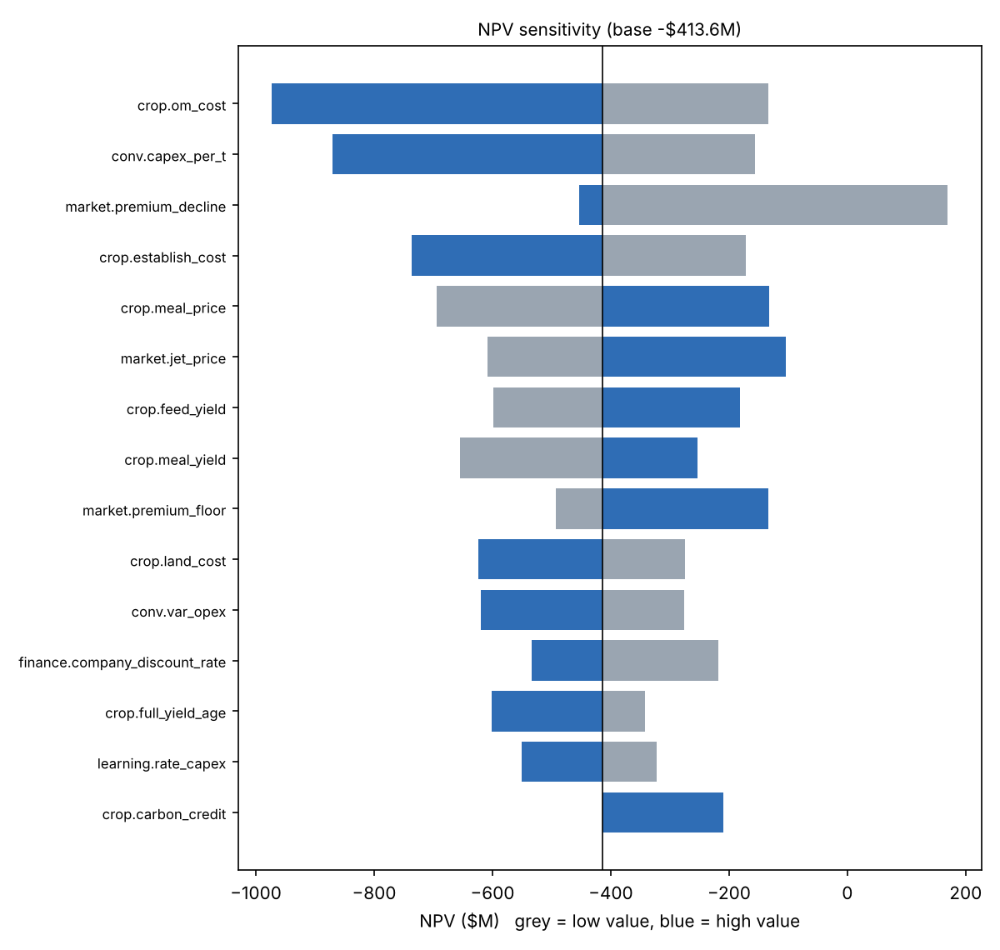
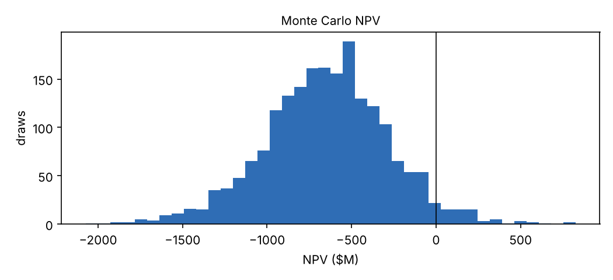

# Afforestation: pongamia on degraded land to HEFA SAF: TEA results

## Conventions

- Real 2026 US dollars (pre-tax). Canadian and euro figures converted at the fx rates below.
- Unit costs are entered at NOAK (Nth of a kind). The cost of getting there is shown separately with Wright's-law learning curves.
- **Boundary:** Plantation establishment to SAF, co-products and press cake (meal) at the refinery gate.
- **Functional units:** Levelized SAF supply cost ($/t fuel); cost of CO2e avoided ($/t).
- Company discount rate 10%, customer discount rate 8%, horizon 15 years.

## Headline

| Metric | Value |
|---|---|
| NPV | -$413.6M |
| IRR | 7% |
| Probability NPV > 0 (Monte Carlo) | 3% |
| Peak cash need | $2.35B |
| Cash breakeven year | not within horizon |
| Revenue in final year | $501.1M |
| NOAK reached in year | 12 |
| Extra cost paid while learning (FOAK to NOAK) | $264.7M |
| NPV if costs started at NOAK (no learning period) | -$269.0M |

## Customer cost vs BAU

**SAF supply cost (levelized over plant life)** ($/t fuel)

| Option | Value | vs ours |
|---|---|---|
| Ours at NOAK (MSP) | $1,648 | 1.00x |
| Ours, first plant (FOAK MSP) | $2,143 | 1.30x |
| HEFA SAF market price (incumbent SAF) | $2,214 | 1.34x |
| Projected SAF price in 2035 (this model) | $1,718 | 1.04x |
| Fossil jet | $735 | 0.45x |
| Fossil jet + ReFuelEU penalty | $3,693 | 2.24x |

MSP credits co-products and other revenue. The penalty is at least twice the SAF-jet price gap per tonne missed.

**Cost of CO2e avoided** ($/t CO2e)

| Option | Value | vs ours |
|---|---|---|
| Ours at NOAK | $321 | 1.00x |
| HEFA SAF at market price | $455 | 1.42x |

Price premium over fossil jet divided by life-cycle CO2e avoided per tonne.

**Mature plantation block (t/yr)**

| Stream | Value |
|---|---|
| area ha | 30,000 |
| feed | 60,000 |
| liquids | 49,800 |
| saf range | 29,880 |
| meal | 105,000 |

## FOAK to NOAK

Cost multiplier vs the incumbent's cost for each component (1.00 = incumbent).

| Component | FOAK | NOAK |
|---|---|---|
| plant capex | 1.47 | 1.00 |

## Cash flow

| Year | Phase | Revenue | Gross profit | Operating cost | EBIT | Capex | Cumulative cash | Cost vs incumbent |
|---|---|---|---|---|---|---|---|---|
| 1 | R&D | $0 | $0 | $20.0M | -$20.0M | $0 | -$20.0M | 1.47 |
| 2 | R&D | $0 | $0 | $20.0M | -$20.0M | $0 | -$40.0M | 1.47 |
| 3 | commercial | $0 | -$18.0M | $10.0M | -$28.0M | $132.1M | -$200.1M | 1.47 |
| 4 | commercial | $0 | -$18.0M | $10.0M | -$28.0M | $0 | -$228.1M | 1.47 |
| 5 | commercial | $0 | -$36.0M | $10.0M | -$46.0M | $291.6M | -$565.7M | 1.29 |
| 6 | commercial | $18.7M | -$26.9M | $10.6M | -$37.5M | $0 | -$603.2M | 1.29 |
| 7 | commercial | $37.0M | -$30.4M | $11.1M | -$41.5M | $262.2M | -$906.8M | 1.20 |
| 8 | commercial | $72.9M | -$25.8M | $12.2M | -$38.0M | $102.3M | -$1.05B | 1.14 |
| 9 | commercial | $107.9M | -$16.2M | $13.2M | -$29.5M | $241.4M | -$1.32B | 1.09 |
| 10 | commercial | $159.7M | $553,633 | $14.8M | -$14.2M | $230.7M | -$1.56B | 1.05 |
| 11 | commercial | $210.2M | $16.0M | $16.3M | -$274,200 | $222.6M | -$1.79B | 1.02 |
| 12 | commercial | $276.8M | $43.9M | $18.3M | $25.6M | $216.0M | -$1.98B | 1.00 |
| 13 | commercial | $341.9M | $70.2M | $20.3M | $50.0M | $212.5M | -$2.14B | 1.00 |
| 14 | commercial | $422.4M | $108.3M | $22.7M | $85.6M | $209.5M | -$2.26B | 1.00 |
| 15 | commercial | $501.1M | $144.6M | $25.0M | $119.5M | $209.5M | -$2.35B | 1.00 |

Revenue in the final year by stream:

- saf: $269.7M (54%)
- coproducts: $105.4M (21%)
- meal: $126.0M (25%)

## Break-evens

| Question | Answer | Base input |
|---|---|---|
| Annual decline in SAF premium for NPV = 0 | 0.00739 | 0.04 |
| Long-run SAF premium floor ($/t) for NPV = 0 | 1,266 | 700 |
| Mature oil yield (t/ha-yr) for NPV = 0 | 3.79 | 2 |
| Establishment cost per ha for NPV = 0 | 442 | 3,000 |
| Carbon credit per ha-yr for NPV = 0 | 305 | 0 |

## Scenarios

| Scenario | NPV | Final-year revenue | Peak cash need |
|---|---|---|---|
| Agave on semi-arid land, ethanol to alcohol-to-jet | -$1.62B | $765.7M | $5.59B |
| Pongamia with carbon credits ($100/ha-yr) | -$278.0M | $534.1M | $2.15B |
| Pongamia at Terviva-level oil yield (3 t/ha) | -$182.1M | $688.6M | $2.53B |
| SAF premium holds at today's level | $169.3M | $628.2M | $1.93B |
| SAF premium falls 8%/yr | -$452.3M | $488.7M | $2.46B |

## Sensitivity (one input at a time)

| Input | Low | NPV at low | High | NPV at high |
|---|---|---|---|---|
| `crop.om_cost` | 300 | -$134.0M | 900 | -$972.6M |
| `conv.capex_per_t` | 1,500 | -$156.5M | 4,000 | -$870.5M |
| `market.premium_decline` | 0.0 | $169.3M | 0.1 | -$453.0M |
| `crop.establish_cost` | 1,500 | -$171.1M | 5,000 | -$736.9M |
| `crop.meal_price` | 100 | -$694.6M | 300 | -$132.5M |
| `market.jet_price` | 600 | -$607.9M | 950 | -$104.0M |
| `crop.feed_yield` | 1.2 | -$598.8M | 3.0 | -$182.1M |
| `crop.meal_yield` | 2.0 | -$654.5M | 4.5 | -$253.0M |
| `market.premium_floor` | 300 | -$492.2M | 1,100 | -$133.1M |
| `crop.land_cost` | 0 | -$273.8M | 250 | -$623.2M |
| `conv.var_opex` | 150 | -$276.1M | 400 | -$619.7M |
| `finance.company_discount_rate` | 0.08 | -$218.8M | 0.15 | -$533.7M |
| `crop.full_yield_age` | 6 | -$341.9M | 10 | -$601.6M |
| `learning.rate_capex` | 0.05 | -$322.3M | 0.2 | -$551.2M |
| `crop.carbon_credit` | 0 | -$413.6M | 150 | -$210.2M |

## Monte Carlo

2,000 draws, triangular distribution on every input with a range.

| P10 | P50 | P90 | P(NPV > 0) |
|---|---|---|---|
| -$1.12B | -$643.4M | -$199.1M | 3% |

## Kill metrics

| Metric | Value | Threshold | Passes |
|---|---|---|---|
| NOAK MSP vs HEFA SAF price | 0.74 x (<=1 to win) | 1.00 | yes |
| NOAK MSP vs projected 2035 SAF price | 0.96 x (<=1 to win) | 1.00 | yes |
| Cost of CO2e avoided at NOAK | 321.23 $/t (<=300) | 300.00 | no |
| Mature SAF yield per hectare | 1.00 t SAF/ha-yr (>=1.0) | 1.00 | no |
| Revenue at full scale vs big-enough line | 0.50 x | 1.00 | no |
| Probability NPV > 0 | 3% | 50% | no |

## Scorecard

Economics is scored from P(NPV > 0); the rest are judgment scores set in the inputs file.

| Category | Weight | Score |
|---|---|---|
| impact | 20% | 4 |
| breakthrough | 20% | 2 |
| feasibility | 15% | 3 |
| economics | 15% | 1 |
| scalability | 10% | 2 |
| demand | 10% | 5 |
| white space | 5% | 2 |
| validation | 5% | 2 |
| **Weighted total** | | **2.70** |

## Notes

- Fuel from crops on severely degraded land counts as an Annex IX Part A feedstock under ReFuelEU.
- Land check: 30 kha per block; SAF yield 1.00 t/ha-yr at maturity.
- Market check: 11 plants at maturity make 329 kt/yr of SAF-range fuel, 3.6% of the ~9.2 Mt/yr the EU mandate requires in 2035.
- One mature plant: 29.9 kt/yr SAF-range fuel (0% from fossil carbon), 19.9 kt/yr co-products.
- SAF price path: premium over jet $1,362/t in model year 1 (2027), $983/t in 2035, $769/t in year 15.
- NPV and IRR include the remaining-life operating cash of plants built within the 15-yr horizon (no new builds after it) while it stays positive; 25 tail years counted. NPV over the horizon alone: $-1,076M.
- Pre-tax, real 2026 USD; operating profit is before depreciation.

